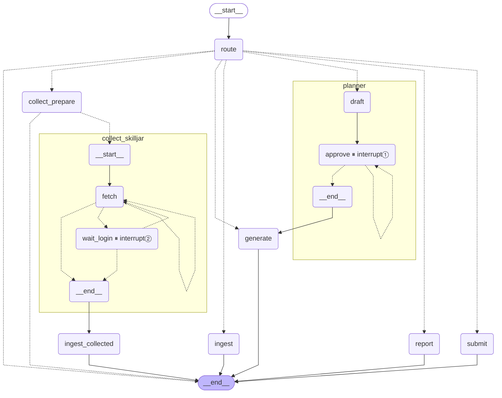

# MissLens

자격증 시험 대비 학습 코치 에이전트입니다. 학습자가 지정한 자료로 실전형 문제 세트를 내고, 틀린 문제를 **개념 실수와 해석 실수**로 나눠 진단합니다. 놓친 조건 문구를 기록해 약점 위주로 다시 출제합니다. 첫 시험 팩은 CCA-F(Claude Certified Architect – Foundations, 시험 코드 CCAR-F)입니다.

핵심 루프: **계획 → 세트 풀이 → 제출 → 한국어 재질문(미끼 포함) → 개념/해석/불확실 진단 → 기록 → 약점 반영 재출제**

| 문서 | 내용 |
|---|---|
| [SERVICE.md](SERVICE.md) | 무엇을, 왜 만드는가(기능 요구사항 F1~F10, 성공 기준) |
| [ARCHITECTURE.md](ARCHITECTURE.md) | 구조, 흐름, 데이터 모델, 기술 결정(D1~D42) |
| [TASK.md](TASK.md) | 진행 상황과 작업 로그 |
| [TODOS.md](TODOS.md) | v1 이후 할 일 |
| [CLAUDE.md](CLAUDE.md) | 코딩 에이전트용 규칙 |

## 구조

Supervisor 그래프 하나가 요청을 6개 에이전트로 보냅니다. interrupt는 두 곳(계획 승인, 로그인 대기)에만 있습니다. 아래 그림은 컴파일된 그래프에서 생성했습니다(`python scripts/draw_graph.py`).

| 에이전트 | 하는 일 | 모델 |
|---|---|---|
| Supervisor | 명령은 바로 분기, 자유 발화는 의도·영역·문제 수 추출, 애매하면 실행하지 않음 | Haiku 4.5 |
| Planner | 학습 기록 통계로 오늘의 계획 제안 → **interrupt①** 승인·수정 | Haiku 4.5 |
| Generator | 세부 항목 선택(범위 먼저, 그다음 약점) → 검색 → 이중 언어 문제 → validator → 근거 검증 | Sonnet 4.6 / Haiku 4.5 |
| Grader & Diagnostician | 제출 채점, 재질문 폼(오답 + 미끼), 판정 표, 놓친 문구, 해설 | Sonnet 4.6 |
| Reporter | 범위·정답률·실수 비율(미끼 기준선과 나란히)·놓친 문구 순위 | 없음 |
| Collector | 학습자 로그인 프로필로 지정 교안을 읽기 전용 수집 → **interrupt②** 로그인 대기 | 없음 |
| Ingest | 청크 분할 → 세부 항목 태깅 → bge-m3 + FAISS + BM25 색인 | Haiku 4.5 |



## 설치

macOS 기준, Python 3.11 이상입니다.

```bash
uv venv --python 3.12 .venv
uv pip install -e ".[dev]"
source .venv/bin/activate
crawl4ai-setup                            # Collector용 Playwright Chromium 설치(바로 내려받기 시작)
```

저장소 루트에 `.env`를 만들고 Amazon Bedrock 자격 증명을 넣습니다(git 제외).

```
AWS_ACCESS_KEY_ID=...
AWS_SECRET_ACCESS_KEY=...
AWS_DEFAULT_REGION=us-east-1
```

모델 ID, 리전, 엔드포인트 전환 순서는 `config/models.yaml`에만 있습니다. 쓸 수 있는 조합은 다음으로 확인합니다.

```bash
python scripts/probe_models.py      # 엔드포인트 5개 × 모델 4개 응답 여부, 할당량 초과 기록
```

임베딩 모델(bge-m3, 약 2GB)은 처음 색인할 때 내려받습니다.

## 처음 쓰는 순서

```bash
# 1) 자료 넣기: 시험 가이드 등 파일이나 폴더(PDF/MD/TXT/HTML)
python -m misslens.cli ingest data/sources/exam_guide
python -m misslens.cli search "tool_choice" --task 2.3      # 검색 확인

# 2) (선택) 로그인이 필요한 교안 수집: sources.yaml에 적힌 URL만
python -m misslens.cli collect login skilljar   # 보이는 브라우저에서 직접 로그인·수강 등록 후 q
python -m misslens.cli collect run              # 창 없이 수집 → 색인. 세션이 만료되면 멈추고 다시 로그인 요청

# 3) (선택) 직접 저장한 연습 문제를 문체 예시로
python -m misslens.cli practice import

# 4) 공부
python -m misslens.cli plan -n 10               # 계획 제안 → 승인 → 풀이 → 리뷰 → 진단
python -m misslens.cli ask "도구 설계 영역 5문제"  # 자연어 지시
python -m misslens.cli status                   # 현황
streamlit run app/main.py                       # 화면(학습·자료·현황·계획 탭)
```

로그인 창은 프로그램이 도는 컴퓨터에 뜹니다. 원격(SSH)으로 개발한다면 `collect login`은 그 컴퓨터 화면(직접 또는 화면 공유)에서 실행하고, `collect run`은 SSH에서 실행해도 됩니다.

## 명령

| 명령 | 하는 일 |
|---|---|
| `quiz [-n 5]` | 바로 세트 풀이 → 제출 → 리뷰 → 진단 |
| `plan [-n 10]` | Planner 계획 → 승인(interrupt①) → 풀이 |
| `ask "<문장>"` | Supervisor 자유 발화 라우팅 |
| `status` | 현황 보고서 |
| `ingest <경로>... [--paste 이름]` | 자료 색인(붙여넣기는 표준 입력) |
| `search "<질의>" [--task ID]` | 검색 결과 확인 |
| `collect login\|run [site] [--thread ID] [--limit N]` | 로그인 프로필 저장 / 수집(중단한 수집은 `--thread`로 재개) |
| `practice import [DIR]` | 연습 문제 파일 → 문체 예시 은행 |

모든 명령은 `python -m misslens.cli <명령>`으로 실행하고, 시험은 `--exam ccar-f`(기본값)로 고릅니다.

## 데이터와 보안

| 위치 | 내용 | git |
|---|---|---|
| `exams/<exam_id>/exam.yaml` | 시험 팩(영역·비중·세부 항목·언어·형식, version) | 포함 |
| `exams/<exam_id>/sources.yaml` | 수집 대상 URL과 사이트 규칙 | 포함 |
| `data/ledger.sqlite` | 학습 기록(세트·문제·풀이·놓친 문구·자료·생성 실패) | 제외 |
| `data/checkpoints.sqlite` | LangGraph 체크포인트(interrupt 재개) | 제외 |
| `data/index/<exam_id>/` | FAISS 색인과 청크 | 제외 |
| `data/sources/` | 넣은 자료, 수집본, 연습 문제 원본 | 제외 |
| `secrets/profiles/<site>/` | 브라우저 로그인 프로필(권한 0700) | 제외 |

- 에이전트는 비밀번호를 입력하거나 저장하지 않습니다. 로그인은 사람이 직접 합니다.
- 수집한 본문은 지시가 아니라 참고 자료로만 프롬프트에 넣습니다.
- 예상문제 사이트는 자동으로 수집하지 않습니다. 직접 저장한 연습 문제는 문체 예시로만 쓰고, 출제 근거나 그대로 출제하는 문제로 쓰지 않습니다.
- 검증(validator → 근거 검증)을 통과하지 못한 문제는 보여 주지도, 기록하지도 않습니다.

## 테스트

```bash
pytest                 # 기본: 가짜 LLM(GenericFakeChatModel), 메모리 DB. 실호출 제외
pytest -m live         # Amazon Bedrock 실호출 스모크(할당량 사용)
```

Streamlit 화면은 `streamlit.testing`의 AppTest로 실제 앱 스크립트를 돌려 검사합니다(`tests/test_ui.py`).
