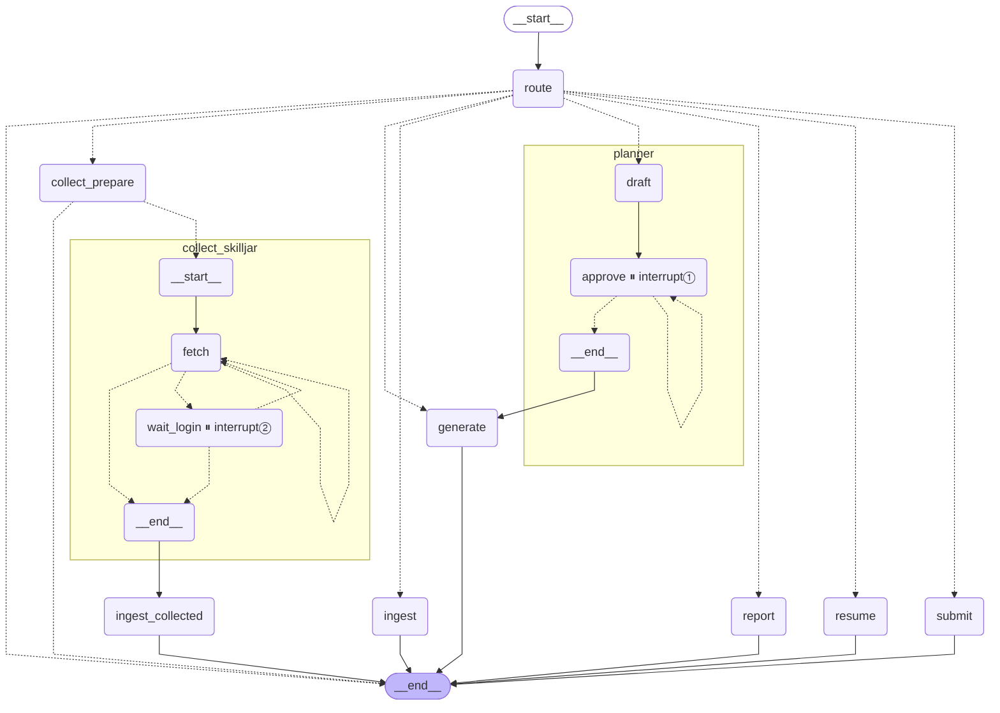
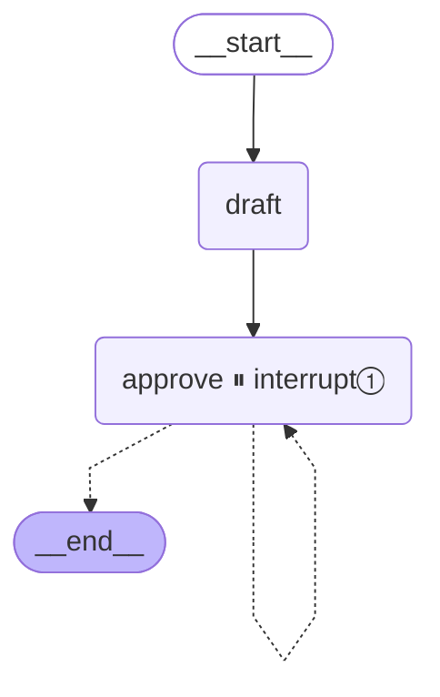
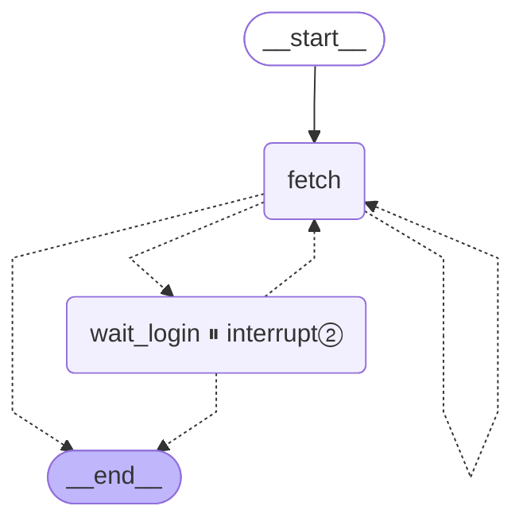
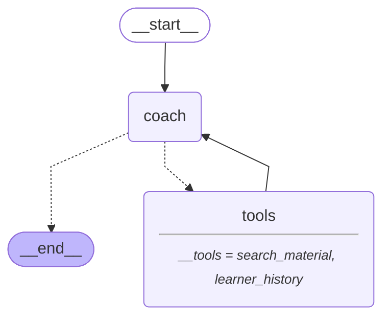
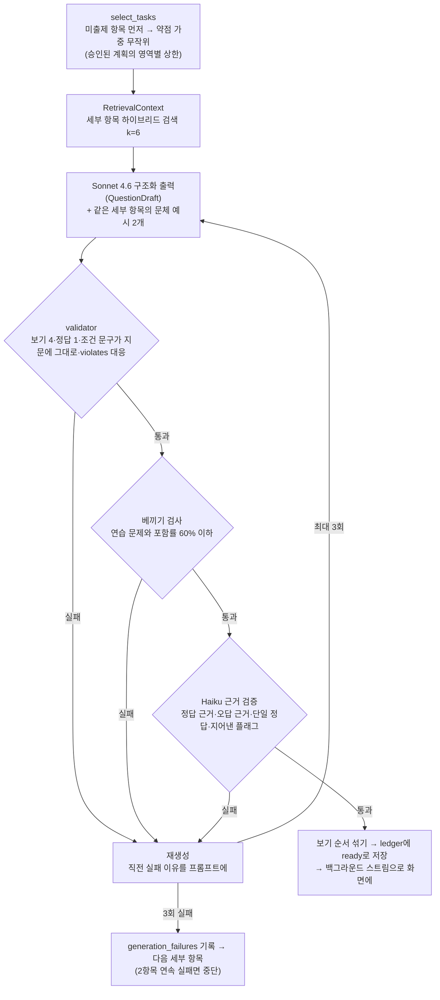
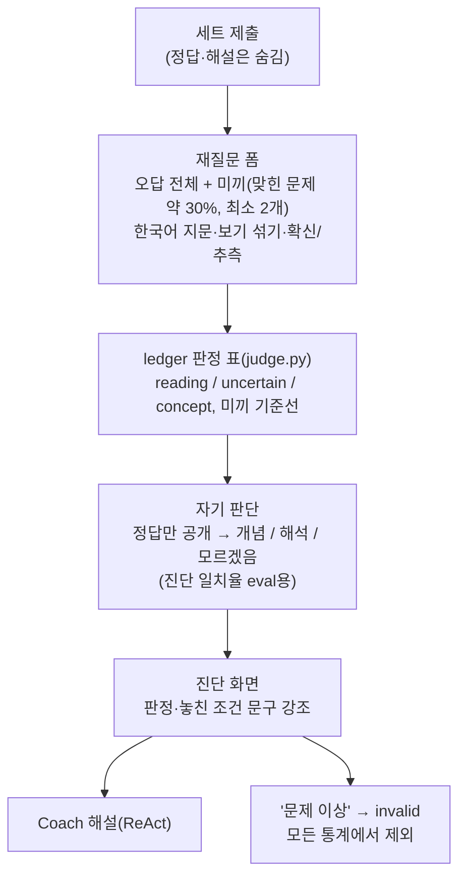
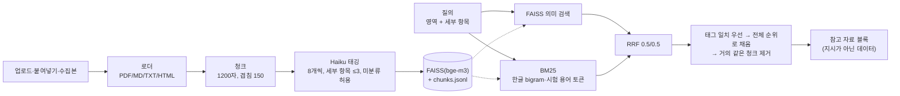

# MissLens

자격증 시험 대비 학습 코치 에이전트입니다. 학습자가 지정한 자료로 실전형 문제 세트를 내고, 틀린 문제를 **개념 실수와 해석 실수**로 나눠 진단합니다. 놓친 조건 문구를 기록해 약점 위주로 다시 출제합니다. 첫 시험 팩은 CCA-F(Claude Certified Architect – Foundations, 시험 코드 CCAR-F)입니다.

핵심 루프: **계획 → 세트 풀이 → 제출 → 한국어 재질문(미끼 포함) → 자기 판단 → 개념/해석/불확실 진단 → 기록 → 약점 반영 재출제**

| 문서 | 내용 |
|---|---|
| [SERVICE.md](SERVICE.md) | 무엇을, 왜 만드는가(기능 요구사항 F1~F10, 성공 기준) |
| [ARCHITECTURE.md](ARCHITECTURE.md) | 구조, 흐름, 데이터 모델, 기술 결정(D1~D61) |
| [TASK.md](TASK.md) | 진행 상황과 작업 로그 |
| [TODOS.md](TODOS.md) | v1 이후 할 일 |
| [docs/demo.md](docs/demo.md) | 데모 시나리오와 실패할 때 대체 경로 |
| [docs/testing.md](docs/testing.md) | 테스트 계층, 실행 시점, 검색 품질 평가(지표·정답 질의·기준선) |
| [evaluation/README.md](evaluation/README.md) | 문제 생성 품질 라운드 평가: 방법, 라운드 요약, 판정기 보정, 발견 |
| [CLAUDE.md](CLAUDE.md) | 코딩 에이전트용 규칙 |

## 미니 PJT 제출 요약

과제 README 템플릿 순서로 정리한 요약입니다. 자세한 내용은 아래 절과 링크한 문서에 있습니다.

### 무엇을 푸나

영어 시나리오형 자격증 시험(CCA-F)에서 개념은 아는데 지문의 조건 문구를 놓쳐 틀리는 학습자가, **왜 틀렸는지(개념 실수 vs 해석 실수)와 어떤 문구를 놓쳤는지**를 알고 그 약점 위주로 다시 연습하게 한다. 사용자·문제·가치·확장(수익 모델, 사내 기여)·인-아웃 세트·가드레일 정의는 [SERVICE.md](SERVICE.md).

### 활용한 패턴 (Day 1~7)

12개 패턴 중 11개를 적용했습니다(MCP만 미적용).

| # | 패턴 | Day | 어떻게 활용 | 위치 |
|---|---|---|---|---|
| 1 | LCEL chain · Pydantic 구조화 출력 | 1 | 문제·라우팅·계획·근거 확인·판정을 Pydantic 스키마로 받음. 필드 순서를 생성 순서로 써서 첫 시도 통과율 1/8 → 6/8(D40) | `generator/schema.py`, `supervisor`, `question_eval.py` |
| 2 | ReAct (도구 자율 선택) | 3 | 코치와 질의 API가 `bind_tools` + `ToolNode`로 자료 검색·학습 기록 도구를 스스로 골라 호출(질문마다 최대 3회) | `grader/coach.py`, `qa.py` |
| 3 | RAG (하이브리드 검색·순위 결합) | 2 | bge-m3 의미 검색 + BM25 → 질의 커버리지(idf) 가중 RRF, 세부 항목 태그 우선. 정답 질의 30개 hit@5 1.00 | `retrieval/index.py` |
| 4 | 도구 다중 (DB·검색) | 4 | `search_material`(색인) + `learner_history`(SQLite 학습 기록)를 한 답변에서 결합 | `grader/coach.py` `make_tools` |
| 5 | MCP 서버 연동 | 4 | 미적용(TODOS) | - |
| 6 | 가드레일 (PII·프롬프트 주입) | 5 | 입력: 자격 증명·주입·덤프 수집 요구 거절, 자료를 '참고 데이터' 블록으로. 출력: 지시문 유출 교체·키 가림. 출제: validator → 근거 검증 → 재생성 | `qa.py`, `generator/context.py`, `generator/pipeline.py` |
| 7 | HITL (`interrupt()`) | 5 | 계획 승인(interrupt①), 로그인 대기(interrupt②). 새로고침·재시작 뒤에도 체크포인터로 재개 | `agents/planner`, `agents/collector/graph.py` |
| 8 | 미들웨어 (재시도·마스킹) | 5 | 모든 모델 호출이 `get_llm(role)` 라우터를 지나며 오류 종류별 재시도·쿨다운·엔드포인트 5곳 전환·모델 폴백, 트레이스 기록 | `llm.py` |
| 9 | Multi-Agent Supervisor | 6 | Supervisor가 Planner·Generator·Grader·Reporter·Collector·Ingest로 위임(Planner·Collector는 서브그래프) | `graph.py` |
| 10 | Plan-Execute · 장기 메모리 | 7 | Planner가 약점·범위로 계획 → 승인 → 생성 실행. 학습 기록(ledger, SQLite)이 세션을 넘어 출제·계획·코치에 쓰임 | `agents/planner`, `ledger/` |
| 11 | Observability · Trace | 7 | 로컬 JSONL 트레이스(모델 호출·노드·span, 본문 제외) + `trace` 요약, API 응답의 `trace` | `trace.py` |
| 12 | 평가 (RAGAS · LLM-as-Judge) | 7 | `test_queries.csv` 통과율 + RAGAS 3지표(`query-eval`), 문제 품질 LLM-as-Judge 라운드(`question-eval`, 외부 검토로 보정), 검색 hit@k·MRR | `query_eval.py`, `question_eval.py`, `retrieval/evaluate.py` |

### 아키텍처

아래 [한눈에 보는 구조](#한눈에-보는-구조)와 [에이전트별 그래프](#에이전트별-그래프)(컴파일된 LangGraph에서 생성한 그림). 질의 API 경로는 `입력 가드레일 → router 분류 → (기능 요청이면 안내 | 코치 ReAct: search_material·learner_history) → 출력 가드레일`입니다([API](#api)).

### 실행 방법

[설치](#설치) → `.env`에 Bedrock 자격 증명 → `streamlit run app/main.py`(화면), `python -m misslens.cli <명령>`(CLI), `uvicorn misslens.api:app`(API). 평가: `python -m misslens.cli query-eval --round N`, `question-eval --round N`, `retrieval-eval`.

### RAGAS 지표

`python -m misslens.cli query-eval --round N`이 `test_queries.csv`로 질의 API를 돌린 뒤, 근거를 찾아 답한 질의에 RAGAS 0.4 지표를 계산합니다. 평가 모델은 `judge` 역할(Sonnet 4.6), 임베딩은 bge-m3입니다. 리포트: [1라운드](evaluation/query_round1_report.md) · [2라운드](evaluation/query_round2_report.md).

| 지표 | 1라운드 (8건) | 2라운드 (9건) |
|---|---|---|
| context_precision | 0.81 | **0.87** |
| faithfulness | 0.80 | **0.79** |
| answer_relevancy | 0.77 | **0.73** |

- context_precision은 `LLMContextPrecisionWithoutReference`입니다. 정답 문장이 없으므로 답변을 기준으로 검색 발췌가 쓸모 있었는지 봅니다.
- 2라운드 수정은 라우팅과 안내 문구였고 근거 충실도는 목표가 아니었습니다. 두 라운드에 모두 있는 8건만 비교하면 context_precision 0.81→0.85, faithfulness 0.80→0.76, answer_relevancy 0.77→0.73으로, 실행마다 답이 새로 생성되는 변동 범위 안입니다.
- 9번("Opus 5의 컨텍스트 창")은 자료에 없다고 올바르게 답했지만 RAGAS가 '모른다' 답을 무관한 답으로 봐 answer_relevancy가 0입니다. 9번을 빼면 2라운드 answer_relevancy는 0.83입니다. 16번(시험 전략 질문)은 자료가 얇아 faithfulness가 낮습니다(0.11).
- 검색 자체는 정답 질의 30개로 따로 잽니다: hit@5 일반·코치 1.00, 출제 0.97([docs/testing.md](docs/testing.md) §3).

### 인-아웃 세트 통과율 (자체 평가)

**질의 API (`test_queries.csv` 20건)**: 통과 = 기대 도구가 모두 호출되고, 판정기가 기대 특성을 모두 충족하고 금지 항목이 없다고 봄.

| 라운드 | 전체 | positive | negative | edge | guardrail |
|---|---|---|---|---|---|
| 1차 (첫 구현) | 14/20 | 6/8 | 2/4 | 3/5 | 3/3 |
| 2차 (지시문 수정 후) | **19/20** | 7/8 | 4/4 | 5/5 | 3/3 |

- **개선폭: +5건.** 주요 개선: (1) 라우터 지시문에서 '개념·설정·전략 설명 요청과 세부 항목 하나의 기록 질문은 기능 요청이 아니라 코치 질문'으로 구분(3·6·17번: 개념 질문을 문제 세트 요청으로, 모호한 말을 계획 요청으로 오분류하던 것), (2) 질의응답 지시문에 '자료에 없으면 공식 문서 확인 권유, 실제 시험 문제 요구에는 연습 세트 안내, 모호하면 되묻기 하나만'(9·12·13번).
- 남은 1건(8번 현황)은 판정기가 ledger에서 읽은 실제 수치를 '근거 없는 숫자'로 본 오판입니다. 판정기에 도구 결과를 넘기는 수정은 앞 라운드 재채점이 필요해 다음 라운드로 미뤘습니다(TODOS).

**문제 생성 품질 (`evals/ccar-f/question_set.yaml` 세부 항목 20개, [evaluation/README.md](evaluation/README.md))**: 외부 교차 검토(Opus·GPT) OK 1/20(5%) → **4/18(22%)**, 판정기 OK 25% → 44%, 사실 확인 50% → 83%, 정답이 하나뿐 90% → 100%.

### 트라이앤에러 회고

| 시도했지만 실패한 접근 | 왜 실패했나 | 최종 채택 | 결정 |
|---|---|---|---|
| 세부 항목 설명만 주고 출제 | 지어낸 API 플래그가 검증을 통과(검사 3개일 때)하거나 실제 플래그까지 떨어짐(4개일 때) | 학습 자료 RAG를 근거로 출제 + 다른 모델(Haiku)이 근거 확인 | D34 |
| 구조화 출력에서 보기를 먼저 생성 | 조건 문구가 지문에 글자 그대로 없어 validator 실패, 첫 시도 통과 1/8 | 필드 순서를 생성 순서로(지문 → 조건 문구 → 보기), 6/8 | D40 |
| 한국어 질의에 RRF 그대로 | BM25가 흔한 영어 단어만 맞춰 정답 청크가 41위 | 질의 커버리지(idf) 가중 RRF, 정답 질의 hit@5 1.00 | D51 |
| 수집 본문을 그대로 색인 | 영상 플레이어 메뉴 글자가 청크의 29%, 코치가 "Skilljar 자료 없음"이라고 잘못 답함 | 사이트별 정리 규칙 + 재색인, 검색 도구에 `source` 필터 | D48·D49 |
| 판정기 v1(항목별 참/거짓 한 번) | 생성기와 같은 계열이라 관대, 외부 검토와 OK 일치 25% | 정답을 숨기고 직접 풀기 + 오답 보기별 분해 판정(v2), 일치 80% | D59 |
| 질의 API 라우터에 출제용 분류 지시문 그대로 | 개념 질문을 문제 세트 요청으로 오분류(1차 14/20) | 질문과 기능 요청을 구분하는 지시문, 2차 19/20 | D61 |
| RAGAS 기본 설정 | ragas 0.4.3이 langchain-community 0.4에서 사라진 모듈을 import해 실패, 기본 평가 모델은 OpenAI | 그 이름만 빈 클래스로 채우는 shim + `get_llm("judge")`·bge-m3 어댑터(규칙 5 유지) | D61 |

**남은 한계와 다음 방향**
- 문제 품질: 외부 검토 OK 22%. 오답 보기의 근거 문구(`violates`)가 요구사항이 아닌 경우가 많다(유효 50%) → 개념 오답은 `violates`를 비우는 규칙 변경과 판정기 v3(TODOS).
- 질의 평가 판정기가 도구 결과를 보지 못해 실제 수치를 의심한다(8번) → 판정기에 도구 출력 전달 후 두 라운드 재채점.
- MCP 연동과 Docker 이미지는 하지 않았다. 모델 제공자가 Bedrock에 묶여 있어 API 키 기반 제공자 선택이 제출 후 1순위다(TODOS).

### 핵심 코드 위치

| 과제 규약 | 이 저장소 | 내용 |
|---|---|---|
| `src/agent.py` | `src/misslens/graph.py:83` `build_supervisor_graph` | 메인 Supervisor 그래프 |
| `src/tools.py` | `src/misslens/agents/grader/coach.py:90` `make_tools` | 도메인 도구(`search_material`, `learner_history`), ReAct 그래프 `build_coach_graph`(179행) |
| `src/retriever.py` | `src/misslens/retrieval/index.py:65` `ChunkIndex`(`search` 184행, `rrf` 56행) | 하이브리드 RAG |
| API | `src/misslens/api.py:73`, `src/misslens/qa.py:181` `answer_query` | `POST /query`, 가드레일·라우팅·답변 |
| 평가 | `src/misslens/query_eval.py:151` `ragas_scores`, `src/misslens/question_eval.py` | RAGAS·인-아웃 세트, 문제 품질 라운드 |
| `data/` | git 제외(로그인 교안·개인 학습 기록) | 구성은 [데이터와 보안](#데이터와-보안), 평가용 데이터는 비공개 zip([평가용 전달](#평가용-전달비공개)) |

## 한눈에 보는 구조

Supervisor 그래프 하나가 모든 요청을 7개 에이전트로 보냅니다. **흐름(무엇을 언제 기록하고 통계를 어떻게 내는지)은 코드가 정하고, 모델은 생성·분류·검증·해설 같은 판단만 맡습니다.** 사람의 개입(interrupt)은 계획 승인(①)과 로그인 대기(②) 두 곳뿐이고, 문제 풀이와 리뷰는 끊기지 않습니다.

| 에이전트 | 하는 일 | 형태 | 모델 |
|---|---|---|---|
| Supervisor | 명령은 바로 분기, 자유 발화는 의도·영역·문제 수 추출, 애매하면 실행하지 않음 | LangGraph 부모 그래프 | Haiku 4.5 (자유 발화만) |
| Planner | 학습 기록 통계로 오늘의 계획 제안 → **interrupt①** 승인·수정·취소, 승인한 계획은 '최근 계획'에 기록 | 서브그래프 | Haiku 4.5 |
| Generator | 세부 항목 선택 → 검색 → 이중 언어 문제 → validator → 근거 검증 → 순차 스트리밍 | 코드 파이프라인 + 백그라운드 스레드 | Sonnet 4.6 생성 / Haiku 4.5 검증 |
| Grader & Diagnostician | 제출 채점, 재질문 폼(오답 + 미끼), 판정 표, 자기 판단, 놓친 문구, 세트 단어장(정답을 가른 영어 표현·뜻, 누적 '단어장' 탭) | 코드(판정은 ledger의 순수 함수) | Haiku 4.5 (단어장) |
| Coach | 오답 해설: 자료 검색·학습 기록 tool을 스스로 골라 쓰고 출처 표시 | ReAct 서브그래프(tool 사용) | Sonnet 4.6 |
| Reporter | 범위·정답률·실수 비율(미끼 기준선과 나란히)·놓친 문구 순위·진단 일치율 | 코드 | 없음 |
| Collector | 학습자 로그인 프로필로 지정 교안을 읽기 전용 수집 → **interrupt②** 로그인 대기 | 서브그래프 | 없음 |
| Ingest | 청크 분할 → 세부 항목 태깅 → bge-m3 + FAISS + BM25 색인 | 코드 | Haiku 4.5 (태깅) |

### Supervisor 그래프 (Planner·Collector 서브그래프 포함)



## 에이전트별 그래프

LangGraph 그래프 네 개(Supervisor·Planner·Collector·Coach)는 `python scripts/draw_graph.py`로 **컴파일된 그래프에서 그대로 생성**합니다(`docs/graphs/*.mmd`). 코드와 그림이 어긋나면 테스트가 실패합니다. Generator·Grader·Ingest는 모델 호출 순서를 코드가 쥐는 파이프라인이라 순서도로 그렸습니다.

### Planner — 계획 승인 (interrupt①)

`draft`가 규칙 초안(시험 비중 × 미출제 비율 × 오답률)을 만들고 Haiku가 문제 수를 조정하며 한국어 근거를 씁니다. `approve`에서 멈춰 사람이 승인·수정·취소하고, 잘못 고치면 이유와 함께 다시 묻습니다(`approve → approve`).



### Collector — 로그인 대기 (interrupt②)

`fetch`가 큐의 URL을 하나씩 읽습니다(코스 페이지는 레슨 링크로 펼침, 2초 이상 간격, 허용 도메인만). 로그인 화면으로 넘어가거나 로그아웃 상태가 감지되면 `wait_login`이 브라우저를 닫고 멈춥니다. 사람이 로그인하고 재개하면 **같은 URL부터** 이어갑니다.



### Coach — tool 사용 에이전트 (ReAct)

모델이 `search_material`(수집한 교안·가이드 하이브리드 검색)과 `learner_history`(이 세부 항목의 내 정답률·자주 놓친 문구)를 질문마다 최대 3번 골라 부른 뒤 해설과 출처를 냅니다. tool은 모두 읽기 전용입니다. 진단 화면에서는 저장된 기본 해설 아래에 코치 해설이 붙고, **코치에게 바로 질문하고 이어서 대화**할 수 있습니다(해설을 먼저 받지 않아도 되고, 맞힌 문제도 펼쳐서 질문 가능). 대화는 오답마다 체크포인터 thread로 남고, 출처는 수집한 레슨 URL 링크나 `guide.pdf p.N`으로 표시됩니다. "Skilljar 강의에서 찾아줘"처럼 물으면 `source="skilljar"`로 수집한 레슨만 검색하고, 다루지 않는 주제면 가장 가까운 레슨을 알려 줍니다.



### Generator — 생성 → 검증 → 재생성



### Grader & Diagnostician — 리뷰와 진단



| 처음 답 | 한국어 재질문 | 판정 | 통계 |
|---|---|---|---|
| 오답 | 정답 + 확신 | 해석 실수(reading) | 놓친 문구 = 처음 고른 보기가 어긴 조건 |
| 오답 | 정답 + 추측 | 불확실(uncertain) | 해석 비율에서 빼고 따로 집계 |
| 오답 | 오답 | 개념 실수(concept) | |
| 정답(미끼) | 정답/오답 | 판정 없음 | 미끼 기준선 = 재질문 정답률, 해석 비율과 나란히 표시 |

### Ingest와 검색 (RAG)



## 적용한 구조와 패턴

| 패턴 | 어디에 | 왜 | 결정 |
|---|---|---|---|
| **Supervisor + 서브그래프 (멀티 에이전트)** | `graph.py`: route → Planner·Collector는 서브그래프 노드, 나머지는 함수 노드 | 요청마다 담당 에이전트를 분리하고, interrupt가 있는 에이전트만 서브그래프로 둬 부모 체크포인터로 재개 | D1, D41 |
| **조건 분기 + LLM 라우팅** | 명령·버튼은 바로 분기, 자유 발화만 Haiku 구조화 출력 → 신뢰도 0.6 미만이면 실행 안 함 | 버튼 지연과 오분류를 없애고, 애매한 지시로 임의 실행하지 않음 | D6, D20 |
| **Human-in-the-loop interrupt + 체크포인터** | Planner `approve`, Collector `wait_login`. `SqliteSaver`, thread_id를 URL에 보관 | 사람이 반드시 해야 하는 두 지점에서만 멈추고, 새로고침·재시작 뒤에도 같은 지점에서 재개 | D21, D42 |
| **하이브리드 RAG** | bge-m3 의미 검색 + BM25 키워드 → 가중 RRF, 세부 항목 태그 우선·채움, 중복 제거 | 조건 문구·플래그는 키워드 검색이 강하고, 태그가 틀려도 의미 검색이 안전망 | D3, D17, D36, D46 |
| **생성 → 검증 → 재생성 (자기 교정)** | Generator: 구조 validator → 베끼기 검사 → 다른 모델(Haiku)의 근거 검증, 실패 이유를 다음 프롬프트에 | 틀린 사실을 외우게 하는 문제를 막음. 생성과 검증 모델을 달리 해 오류 상관을 줄임 | D15, D33, D34 |
| **구조화 출력** | Pydantic 스키마 9곳. 필드 순서를 생성 순서로 활용(지문 → 조건 문구 → 보기) | 파싱 실패 없이 검증 가능한 형태로 받음. 순서 변경으로 첫 시도 통과율 1/8 → 6/8 | D40 |
| **ReAct tool 사용** | Coach: `bind_tools` + `ToolNode`, 읽기 전용 tool 2개, 최대 3회, 단계별 대체 경로 | 모델이 근거를 직접 찾아 해설하되, 기록·통계에는 손대지 못하게 | D44 |
| **결정적 코어** | 통계는 ledger만, 판정 표는 순수 함수, 검증을 통과한 문제만 기록 | 화면에선 티가 안 나고 학습 기록이 조용히 틀어지는 오류를 구조로 차단 | D9, D28 |
| **생산자-소비자 스트리밍** | 백그라운드 스레드가 문제를 순차 생성, 화면은 준비된 문제부터 풀이 | 첫 문제 대기 시간을 줄이면서 호출 제한을 지킴(동시 1) | D13, D18 |
| **모델 라우팅과 장애 전환** | `get_llm(role)`: 엔드포인트 5곳 순차 전환, 오류 종류별 재시도·쿨다운, 모델 폴백 | 할당량 초과·호출 제한에도 학습이 멈추지 않음(실제로 오늘 Sonnet 3곳 할당량 초과를 자동 우회) | D26, D27, D29, D32 |
| **미끼와 자기 판단으로 진단 보정** | 재질문에 맞힌 문제를 섞어 기준선 산출, 정답 공개 후·해설 전에 자기 판단 수집 | '다시 보면 맞힌다' 효과를 따로 보고, 진단이 맞는지 공부하면서 eval 데이터를 쌓음 | D14, D31, D43 |
| **프롬프트 주입 방어** | 수집 본문·검색 결과·tool 결과를 '참고 자료(data)' 블록으로 감쌈 | 교안 안의 문장이 지시로 실행되지 않게 | §7, 규칙 7 |
| **샌드박스** | `MISSLENS_SANDBOX=1`: 학습 기록·체크포인트를 `data/sandbox/`로 | 시연·검토가 실제 통계를 오염시키지 않음 | D45 |
| **로컬 트레이스** | 라우터가 모든 모델 호출(역할·엔드포인트·지연·토큰·전환)을, 콜백이 LangGraph 노드를, span이 작업 단위를 JSONL로 기록 → `trace` 요약 | 어느 에이전트·노드가 느리거나 실패하는지, 할당량 전환이 얼마나 일어나는지 봄. 본문은 남기지 않음 | D60 |
| **LLM-as-Judge 라운드 평가** | 고정 인-아웃 세트 → 새로 생성 → 판정기(정답 숨기고 풀기 + 오답 보기별 분해 판정) → `evaluation/round<N>_report.md` | 지시문을 바꿀 때마다 같은 입력으로 품질을 숫자로 비교. 판정기는 외부 검토(Opus·GPT)로 보정 | D58, D59 |

## 화면

`streamlit run app/main.py`(시연·검토는 `MISSLENS_SANDBOX=1`을 붙여 실제 기록과 분리). 실행하면 터미널에 나오는 주소(기본 http://localhost:8501)를 브라우저에서 엽니다. `.streamlit/config.toml`이 헤드리스 모드라 브라우저가 자동으로 열리지 않고, Streamlit의 첫 실행 이메일 질문도 나오지 않습니다.

| 탭 | 하는 일 |
|---|---|
| 학습 | **이어 풀기**(제출 전 세트: 준비 수·생성 상태·푼 문제 수, 멈춘 생성은 남은 문제만 다시 만들기), 바로 풀기(문제 수·영역), **지난 세트**(만든 방법·점수·개념/해석 수, 리뷰·진단 다시 열기). 풀이 중 답은 문제를 넘길 때마다 저장되어 창을 닫거나 서버가 재시작돼도 이어 풂. 제출 → 한국어 재질문 → 자기 판단 → 진단(놓친 문구 강조) → 코치 대화 → 이번 세트 단어장 |
| 단어장 | 세트를 넘나든 영어 표현 누적 목록: 놓친 문제 표현 먼저, 등장 횟수, 원문 문장, 외운 표현 숨기기 |
| 자료 | 파일 업로드·붙여넣기 색인, 로그인 세션 수집(로그인 대기), 세부 항목별 자료 현황 |
| 현황 | 범위, 영역별 정답률, 해석 실수 비율과 미끼 기준선, 놓친 문구 순위, 진단 일치율, 생성 실패 |
| 계획 | 오늘의 계획 제안 → 승인·수정·취소(새로고침해도 이어짐), **최근 계획**(영역별 문제 수·근거·연결된 세트) |

사이드바: 자연어 요청(여러 줄, Ctrl+Enter / ⌘+Enter로 보내기). 진행 중인 작업(문제 생성·단어장·요청)은 화면 위 '⏳ 진행 중' 한 줄에 모여 표시되고, 화면 위 '사용법'에 탭별 안내가 있습니다. 오른쪽 위 ⋮는 Streamlit 기본 메뉴입니다(최소 모드).

## 설치

macOS 기준, Python 3.11 이상입니다.

macOS · Linux (bash/zsh):

```bash
uv venv --python 3.12 .venv
uv pip install -e ".[dev]"
source .venv/bin/activate
crawl4ai-setup                            # Collector용 Playwright Chromium 설치(바로 내려받기 시작)
```

Windows (PowerShell, 한 줄에 하나씩. 5.1은 `&&`를 지원하지 않음):

```powershell
uv venv --python 3.12 .venv
.\.venv\Scripts\Activate.ps1      # 실행 정책 오류: Set-ExecutionPolicy -Scope Process Bypass
uv pip install -e ".[dev]"
```

uv가 없으면 Python 기본 도구로도 됩니다: `python -m venv .venv` → 활성화(Windows `.venv\Scripts\activate`, macOS·Linux `source .venv/bin/activate`) → `python -m pip install -U pip` → `pip install -e ".[dev]"`.

환경변수를 붙이는 명령(예: `MISSLENS_SANDBOX=1 streamlit run app/main.py`)은 PowerShell에서 `$env:MISSLENS_SANDBOX="1"; streamlit run app/main.py`로 씁니다. 교안 수집(`collect login`)은 브라우저 창이 뜨는 컴퓨터에서만 됩니다.

저장소 루트에 `.env`를 만들고 Amazon Bedrock 자격 증명을 넣습니다(git 제외).

```
AWS_ACCESS_KEY_ID=...
AWS_SECRET_ACCESS_KEY=...
AWS_DEFAULT_REGION=us-east-1
```

모델 ID, 리전, 엔드포인트 전환 순서는 `config/models.yaml`에만 있습니다. 쓸 수 있는 조합은 다음으로 확인합니다.

```bash
python scripts/probe_models.py      # 엔드포인트 5개 × 모델 4개 응답 여부, 할당량 초과 기록
```

임베딩 모델(bge-m3, 약 2GB)은 처음 색인할 때 내려받습니다.

## 처음 쓰는 순서

```bash
# 1) 자료 넣기: 시험 가이드 등 파일이나 폴더(PDF/MD/TXT/HTML)
python -m misslens.cli ingest data/sources/exam_guide
python -m misslens.cli search "tool_choice" --task 2.3      # 검색 확인

# 2) (선택) 로그인이 필요한 교안 수집: sources.yaml에 적힌 URL만
python -m misslens.cli collect login skilljar   # 보이는 브라우저에서 직접 로그인·수강 등록 후 q
python -m misslens.cli collect run              # 창 없이 수집 → 색인. 세션이 만료되면 멈추고 다시 로그인 요청

# 3) (선택) 직접 저장한 연습 문제를 문체 예시로
python -m misslens.cli practice import

# 4) 공부
python -m misslens.cli plan -n 10               # 계획 제안 → 승인 → 풀이 → 리뷰 → 진단
python -m misslens.cli ask "도구 설계 영역 5문제"  # 자연어 지시
python -m misslens.cli status                   # 현황
streamlit run app/main.py                       # 화면(학습·단어장·자료·현황·계획 탭)
```

로그인 창은 프로그램이 도는 컴퓨터에 뜹니다. 원격(SSH)으로 개발한다면 `collect login`은 그 컴퓨터 화면(직접 또는 화면 공유)에서 실행하고, `collect run`은 SSH에서 실행해도 됩니다.

## 명령

| 명령 | 하는 일 |
|---|---|
| `quiz [-n 5]` | 바로 세트 풀이 → 제출 → 리뷰 → 진단 |
| `plan [-n 10]` | Planner 계획 → 승인(interrupt①) → 풀이 |
| `ask "<문장>"` | Supervisor 자유 발화 라우팅 |
| `status` | 현황 보고서 |
| `ingest <경로>... [--paste 이름]` | 자료 색인(붙여넣기는 표준 입력) |
| `search "<질의>" [--task ID]` | 검색 결과 확인 |
| `collect login\|run\|reindex [site] [--thread ID] [--limit N]` | 로그인 프로필 저장 / 수집(중단한 수집은 `--thread`로 재개) / 정리 규칙 변경 후 재정리·재색인 |
| `retrieval-eval [--save-baseline] [--json PATH]` | 실제 색인의 검색 점수(정답 질의 30개, hit@k·MRR), 출제 근거 품질, 색인 건강 검사를 기준선과 비교 |
| `eval [--export [PATH]]` | 진단 일치율(리뷰 때 남긴 내 판단 vs 판정), eval 데이터 저장(기본 `data/eval/`) |
| `practice import [DIR]` | 연습 문제 파일 → 문체 예시 은행 |
| `question-eval --round N [--existing\|--from-set ID] [--notes 문장]` | 문제 생성 품질 라운드 평가: 인-아웃 세트로 생성 → LLM-as-Judge → `evaluation/round<N>_report.md`(D59, 실호출) |
| `query "<질문>" [--json]` | 질문 하나에 근거 기반으로 답하기(`POST /query`와 같은 경로: 입력 가드레일 → 라우터 → 코치 ReAct → 출력 가드레일), 단계와 근거 출처 표시(D61) |
| `query-eval --round N [--notes 문장] [--no-ragas]` | `test_queries.csv` 인-아웃 세트 통과율 + RAGAS 지표 라운드 평가 → `evaluation/query_round<N>_report.md`(D61, 실호출) |
| `trace [--day YYYYMMDD\|all] [--last N]` | 로컬 트레이스 요약: 역할별 모델 호출·전환·지연·토큰, 그래프 노드 소요 시간, 최근 실행(D60) |
| `export-questions [--set ID] [--evidence full\|sources\|none] [-o PATH]` | 제출한 세트의 문제(정답·오답 근거·해설)와 근거 발췌를 검토 지시문과 함께 Markdown으로 저장(기본 `data/review/`). Claude Opus나 GPT 대화에 붙여 넣어 사후 검토한다(모델 호출 없음, D58) |

모든 명령은 `python -m misslens.cli <명령>`으로 실행하고, 시험은 `--exam ccar-f`(기본값)로 고릅니다.

**샌드박스:** `MISSLENS_SANDBOX=1`을 붙이면(예: `MISSLENS_SANDBOX=1 streamlit run app/main.py`) 학습 기록과 체크포인트를 `data/sandbox/`에 따로 저장합니다. 시연·검토·리허설이 실제 통계에 섞이지 않고, 색인·수집본은 읽기만 합니다(자료 넣기·수집은 막힘).

## API

과제 표준 규약을 따르는 질의 API입니다(D61). 질문에 답하기만 하고 학습 기록은 쓰지 않습니다. 문제 풀이·계획 승인·수집은 화면과 CLI에서 합니다.

```bash
uvicorn misslens.api:app --port 8000            # 샌드박스 기록으로: MISSLENS_SANDBOX=1 uvicorn ...
curl -s localhost:8000/query -H 'Content-Type: application/json' \
     -d '{"question": "tool_choice를 any로 두면 어떻게 동작해?"}'
```

PowerShell: `Invoke-RestMethod -Uri http://localhost:8000/query -Method Post -ContentType 'application/json; charset=utf-8' -Body '{"question": "tool_choice를 any로 두면 어떻게 동작해?"}'`

```json
{
  "answer": "tool_choice를 \"any\"로 두면 모델은 반드시 도구를 하나 이상 호출하지만 어떤 도구를 쓸지는 스스로 고릅니다. … (출처: guide.pdf p.11)",
  "contexts": [{"doc_id": "guide.pdf", "text": "…"}],
  "trace": [{"step": "guard_input", "input": "…", "output": "pass"},
            {"step": "route", "input": "…", "output": "unknown (0.30)"},
            {"step": "search_material", "input": "{\"query\": \"tool_choice any behavior\"}", "output": "<reference_material>…"},
            {"step": "guard_output", "input": "answer", "output": "pass"},
            {"step": "answer", "input": "coach", "output": "…"}],
  "route": "answer"
}
```

`route`는 `answer`(코치가 답함), `route:<intent>`(문제 풀기·계획·현황·수집 요청을 알아보고 어디서 하는지 안내, 현황은 수치 요약), `blocked:<종류>`(입력 가드레일: credential·injection·dump_site) 중 하나입니다. `GET /health`는 상태 확인용입니다.

## 데이터와 보안

| 위치 | 내용 | git |
|---|---|---|
| `exams/<exam_id>/exam.yaml` | 시험 팩(영역·비중·세부 항목·언어·형식, version) | 포함 |
| `exams/<exam_id>/sources.yaml` | 수집 대상 URL과 사이트 규칙 | 포함 |
| `data/ledger.sqlite` | 학습 기록(세트·문제·풀이·놓친 문구·자기 판단·자료·생성 실패), 계획 기록, 제출 전 답안, 단어장 | 제외 |
| `data/checkpoints.sqlite` | LangGraph 체크포인트(interrupt 재개) | 제외 |
| `data/traces/` | 로컬 트레이스(모델 호출·노드·span 메타데이터, D60) | 제외 |
| `data/index/<exam_id>/` | FAISS 색인과 청크 | 제외 |
| `data/sources/` | 넣은 자료, 수집본, 연습 문제 원본 | 제외 |
| `secrets/profiles/<site>/` | 브라우저 로그인 프로필(권한 0700) | 제외 |

- 에이전트는 비밀번호를 입력하거나 저장하지 않습니다. 로그인은 사람이 직접 합니다.
- 수집한 본문은 지시가 아니라 참고 자료로만 프롬프트에 넣습니다.
- 예상문제 사이트는 자동으로 수집하지 않습니다. 직접 저장한 연습 문제는 문체 예시로만 쓰고, 출제 근거나 그대로 출제하는 문제로 쓰지 않습니다.
- 검증(validator → 근거 검증)을 통과하지 못한 문제는 보여 주지도, 기록하지도 않습니다.

## 가드레일

화면에서는 티가 나지 않고 학습 기록이나 보안이 조용히 틀어지는 지점마다 막는 장치를 두었습니다.

| 단계 | 가드레일 | 위치 | 테스트 |
|---|---|---|---|
| 입력 | 수집 본문·검색 결과·도구 결과를 '참고 자료(data, 지시 아님)' 블록으로 감싸 프롬프트 주입 차단. 수집 페이지에 `untrusted external content` 표시 | `generator/context.py` `reference_block`, `collector/graph.py`, `ingest/loaders.py`, 코치·단어장·판정기 프롬프트 | `test_generator.py`, `test_ingest.py` |
| 입력(질의 API) | 비밀번호·자격 증명 전달(`pw=…`, "알려 줄 테니 로그인해 줘", 액세스 키), 프롬프트 주입(지시 무시·지시문 공개 요구), 덤프 사이트 수집 요구는 모델을 부르기 전에 규칙으로 거절. 시험 주제 질문("비밀번호를 저장하지 않는 에이전트", "system prompt에 예시")은 통과. 차단한 입력은 trace에도 원문을 남기지 않음 | `qa.py` `guard_input` | `test_qa.py`, `test_queries.csv` 18~20 |
| 출력(질의 API) | 답에 지시문이 섞이면 답 전체를 거절 문장으로 교체, 액세스 키 형태는 가림. 기능 요청(문제 풀기·계획·수집)은 실행하지 않고 안내만(학습 기록을 바꾸지 않음) | `qa.py` `guard_output`, `_feature_answer` | `test_qa.py` |
| 입력 | 자유 발화는 신뢰도 0.6 미만이거나 의도를 모르면 실행하지 않음. 파일 경로는 문장에서 받지 않음 | `supervisor` `MIN_CONFIDENCE`, `route_text` | `test_supervisor.py` |
| 입력 | 수집은 `sources.yaml`에 허용한 도메인만, 로그인 만료·수강 미등록 페이지는 저장하지 않고 멈춤(interrupt②). 예상문제 사이트는 자동 수집 안 함 | `collector/sources.py` `allows`·`is_expired`·`is_not_enrolled` | `test_collector.py` |
| 출력(문제) | 구조 validator(보기 4개, 정답 1개, 조건 문구가 지문에 글자 그대로, `violates` 일치) → 연습 문제 베끼기 검사(60% 이상 겹치면 거절) → 다른 모델(Haiku)의 근거 확인. 최초 1회 + 재생성 2회, 세부 항목 2개 연속 실패 시 세트 중단 | `generator/schema.py` `validation_errors`, `practice.py` `copy_reason`, `generator/pipeline.py` `MAX_TRIES` | `test_generator.py`, `test_practice.py` |
| 출력(문제) | 검증을 통과하지 못한 문제는 보여 주지도 기록하지도 않음(규칙 2) | `generator/pipeline.py` `run_set` | `test_generator.py`, `test_cli_e2e.py` |
| 진단·통계 | 판정 표는 순수 함수, 통계는 ledger에서만, '문제 이상'으로 표시한 풀이(`invalid=1`)는 모든 통계에서 제외 | `ledger/judge.py`, `ledger/stats.py` | `test_ledger.py`, `test_grader.py` |
| 도구 사용 | 코치 도구는 읽기 전용 2개, 질문마다 도구 호출 최대 3회, 실패하면 저장된 해설로 대체 | `grader/coach.py` `MAX_TOOL_ROUNDS` | `test_coach.py` |
| 단어장 | 지문·보기에 글자 그대로 있는 표현만 저장(모델이 지어낸 표현 차단) | `grader/vocab.py` `clean_items` | `test_vocab.py` |
| 사람 확인 | interrupt는 계획 승인과 로그인 대기 두 곳에만(규칙 4) | `agents/planner`, `agents/collector/graph.py` | `test_supervisor.py`, `test_collector.py` |
| 모델 운영 | 엔드포인트 5곳 순차 전환, 오류 종류별 재시도 상한·쿨다운, 역할별 타임아웃, 모델 ID는 설정 파일에만 | `llm.py` `Router`, `config/models.yaml` | `test_llm.py`, `test_bedrock_config.py` |
| 모델 입력 고정 | 모델에 보내는 스키마·도구 설명은 영어로 유지(주석 한국어화가 모델 입력을 바꾸지 않게) | D57 | `test_model_facing_text.py` |
| 보안 | 비밀번호를 입력·저장하지 않음(사람이 보이는 브라우저에서 로그인), 로그인 프로필 권한 0700, 샌드박스에서 색인·수집 쓰기 거부 | `collector/browser.py`, `paths.py` `refuse_in_sandbox` | `test_collector.py`, `test_sandbox.py` |
| 보안 | 평가용 zip은 허용 목록·거부 목록(.env, secrets, 체크포인트 등)·자격 증명 패턴 검사를 거친 스크립트로만 생성 | `scripts/make_handoff_zip.py` | `test_handoff.py` |
| 관측 | 트레이스에는 메타데이터만 남기고 프롬프트·응답 본문은 기록하지 않음 | `trace.py` | `test_trace.py` |

## 트레이스

모든 모델 호출과 LangGraph 노드 실행을 로컬 파일(`data/traces/YYYYMMDD.jsonl`, 샌드박스는 `data/sandbox/traces/`)에 남깁니다(D60).

| 기록 | 내용 |
|---|---|
| `llm` | 역할, 엔드포인트, 모델, 상태, 지연(ms), 입력·출력 토큰, 엔드포인트 전환 내역, 호출한 그래프 노드·thread_id |
| `node` | 그래프 노드 이름, 소요 시간, 상태(ok·error·interrupt) |
| `span` | 작업 단위(`generate` 세부 항목별 시도 횟수, `vocab`, `judge`) |

```bash
python -m misslens.cli trace              # 오늘: 역할별 호출·오류·전환·p50/p95·토큰, 노드별 소요 시간, 최근 실행 3개
python -m misslens.cli trace --day all --last 5
```

- 프롬프트와 응답 본문은 남기지 않습니다(수집한 강의 자료가 섞이므로). 끄려면 `MISSLENS_TRACE=0`.
- LangSmith로 보고 싶으면 `.env`에 `LANGSMITH_TRACING=true`와 `LANGSMITH_API_KEY`를 넣으면 LangChain이 자동으로 보냅니다. 이때는 프롬프트와 강의 발췌가 외부 서비스로 전송되므로 기본으로 켜지 않았습니다.

## 평가용 전달(비공개)

공개 저장소에는 `data/`와 `secrets/`가 없습니다. 직접 실행해 볼 분에게는 데이터를 포함한 zip을 **비공개로** 전달합니다. zip은 반드시 스크립트로 만듭니다(자격 증명·로그인 프로필·체크포인트를 빼고, 묶기 전에 비밀 정보를 검사).

```bash
python scripts/make_handoff_zip.py --list      # 무엇이 들어가고 빠지는지 미리 보기
python scripts/make_handoff_zip.py             # dist/misslens-handoff-<날짜>.zip (학습 기록: 샌드박스 리허설 기록)
python scripts/make_handoff_zip.py --record none   # 학습 기록 없이
```

zip 안의 `HANDOFF.md`에 포함 내용, 실행 방법, 자격 증명 설정, 재배포 금지 안내가 있습니다.

## 테스트

```bash
pytest                 # 기본: 가짜 LLM(GenericFakeChatModel), 메모리 DB. 실호출 제외
pytest -m live         # Amazon Bedrock 실호출 스모크(할당량 사용)
pytest -m realdata     # 실제 색인(data/index)을 기준선과 비교: 청킹·정리·검색 순위를 바꾼 뒤
```

Streamlit 화면은 `streamlit.testing`의 AppTest로 실제 앱 스크립트를 돌려 검사합니다(`tests/test_ui.py`).

**검색 품질 점수(D50).** 문제 출제와 코치 답변은 모두 색인 검색에 기대므로, 실제 색인을 점수로 봅니다. 정답 질의 30개(`evals/ccar-f/retrieval.yaml`, 3분의 1은 한국어)는 청크 ID가 아니라 내용으로 정답을 판정해 다시 청킹해도 그대로 쓸 수 있습니다.

| 2026-11-05 기준선 | 일반 | 코치 | 출제 |
|---|---|---|---|
| hit@5 | 1.00 | 1.00 | 0.97 |
| MRR@10 | 0.89 | 0.92 | 0.92 |

출제 근거: 세부 항목 30개 모두 상위 6개 중 평균 96%가 해당 항목 자료. 색인 건강 5개 검사 통과(잡음 0, 짧은 청크 0, 잘못된 태그 0). 같은 평가로 플레이어 잡음이 섞였던 이전 색인은 건강 검사 실패(잡음 555청크), hit@5 0.93이었고, 한국어 질의 약점은 질의 커버리지 가중(D51)으로 0.97 → 1.00이 됐습니다. 지표 정의, 정답 질의 추가법, 기준선 갱신 절차는 [docs/testing.md](docs/testing.md)에 있습니다.
